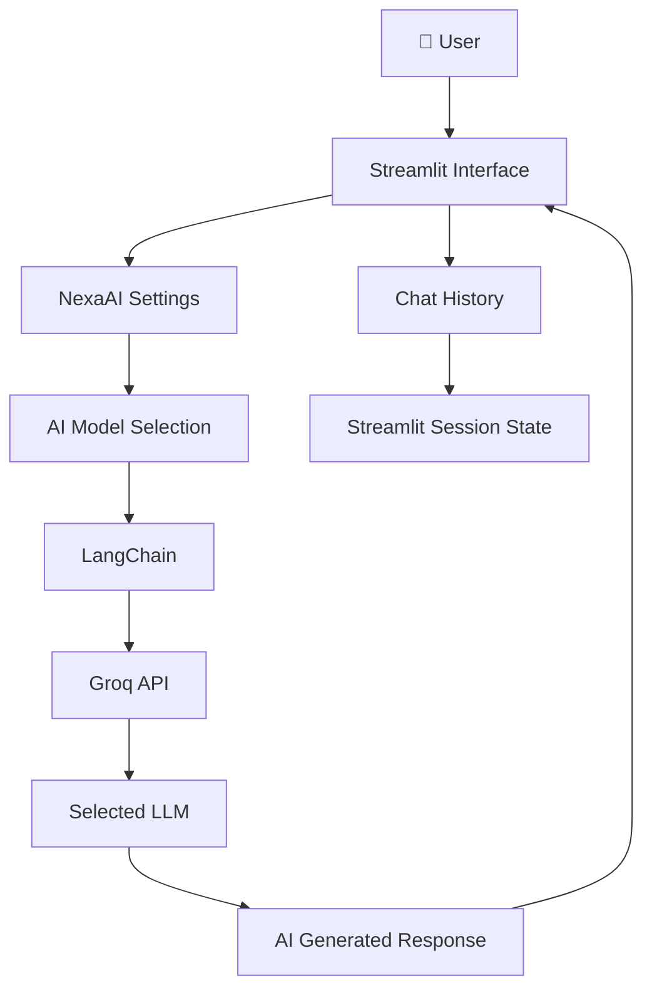

# 🤖 NexaAI – Multi-Model AI Assistant

<div align="center">

  

  ### Your Intelligent Multi-Model AI Assistant

  *Ask Questions • Explore AI Models • Get Intelligent Responses*

  
  
  
  

  
  

  **[GitHub Profile](https://github.com/trupti-connect) • [LinkedIn](https://www.linkedin.com/in/trupti-choure-7466aa402)**

</div>

---

## 📌 Table of Contents

1. [About the Project](#-about-the-project)
2. [Key Features](#-key-features)
3. [Supported AI Models](#-supported-ai-models)
4. [Technology Stack](#️-technology-stack)
5. [System Architecture](#️-system-architecture)
6. [Installation](#️-installation)
7. [Run the Application](#-run-the-application)
8. [Project Structure](#-project-structure)
9. [Application Screenshots](#-application-screenshots)
10. [API Configuration](#-api-configuration)
11. [Future Enhancements](#-future-enhancements)
12. [Author](#-author)

---

## 📖 About the Project

**NexaAI** is a Multi-Model Generative AI Assistant developed using Python, Streamlit, LangChain, and Groq API.

The application provides an interactive platform where users can select different Large Language Models (LLMs), ask questions, customize AI response temperature, and receive intelligent responses.

NexaAI also provides a chat history feature that allows users to create new conversations, revisit previous chats, and manage their conversations during an active application session.

### 🎯 Project Objectives

- Build an interactive Generative AI application.
- Integrate multiple Large Language Models using Groq API.
- Develop an intuitive chatbot interface using Streamlit.
- Implement conversational history management.
- Explore practical applications of LLMs and LangChain.

---

## ✨ Key Features

| Feature | Description |
|---|---|
| 🤖 Multi-Model Selection | Choose from multiple available Groq AI models |
| 💬 Interactive Chatbot | Ask questions and receive AI responses |
| 📚 Chat History | Access previous conversations |
| ➕ New Chat | Start a new conversation |
| 🗑️ Delete Chat | Delete the current conversation |
| ⚙️ Temperature Control | Adjust AI response creativity |
| 🔑 API Integration | Connect using your Groq API key |
| ⌨️ Enter-to-Send | Submit questions using chat input |
| ⚡ Fast AI Inference | Generate responses using Groq |
| 🎨 User-Friendly Interface | Interactive Streamlit application |

---

## 🤖 Supported AI Models

NexaAI integrates multiple models through Groq API.

| Model | Model ID |
|---|---|
| Qwen 3.8 27B | `qwen/qwen3.8-27b` |
| GPT OSS 120B | `openai/gpt-oss-120b` |
| GPT OSS 20B | `openai/gpt-oss-20b` |

*Note: Model availability depends on the current Groq API catalogue. Model IDs may need updating.*

---

## 🛠️ Technology Stack

| Technology | Application |
|---|---|
| Python | Core programming language |
| Streamlit | Web application interface |
| LangChain | LLM integration |
| LangChain-Groq | Groq model connectivity |
| Groq API | AI model inference |
| Session State | Conversation management |
| UUID | Unique chat identification |

---

## 🏗️ System Architecture



### Application Workflow

1. User opens the NexaAI application.
2. Enters a Groq API key.
3. Selects an AI model.
4. Adjusts temperature settings.
5. Enters a question.
6. LangChain sends the request to Groq.
7. The selected LLM generates a response.
8. NexaAI displays and stores the conversation in session state.

---

## ⚙️ Installation

### 1. Clone the Repository

```bash
git clone https://github.com/trupti-connect/Multi-Model-Groq-AI-Assistant.git
```

### 2. Navigate to the Project

```bash
cd Multi-Model-Groq-AI-Assistant
```

### 3. Create a Virtual Environment

```bash
python -m venv venv
```

**Activate on Windows:**

```bash
venv\Scripts\activate
```

**Activate on macOS/Linux:**

```bash
source venv/bin/activate
```

### 4. Install Dependencies

```bash
pip install -r requirements.txt
```

---

## 🚀 Run the Application

Execute the following command:

```bash
streamlit run app.py
```

Open your browser:

```text
http://localhost:8501
```

### 💡 How to Use NexaAI

1. Enter your Groq API key.
2. Select your preferred AI model.
3. Adjust the temperature.
4. Enter your question in the chat input.
5. Press Enter to generate a response.
6. View and manage previous conversations from Chat History.

---

## 💻 Project Structure

```text
Multi-Model-Groq-AI-Assistant/
│
├── app.py
│   └── Main Streamlit application
│
├── requirements.txt
│   └── Project dependencies
│
├── README.md
│   └── Project documentation
│
├── .gitignore
│   └── Git ignored files
│
└── screenshots/
    ├── home.png
    ├── model-selection.png
    └── chat-history.png
```

---

## 📸 Application Screenshots

### 🏠 NexaAI Home Interface


### 🤖 AI Model Selection


### 💬 Chat History


---

## 🔐 API Configuration

NexaAI uses Groq API to access supported Large Language Models.

### Get Your Groq API Key

1. Visit [Groq Console](https://console.groq.com/).
2. Create or sign in to your account.
3. Navigate to API Keys.
4. Generate your API key.
5. Enter your key into the NexaAI application sidebar.

### Security Best Practices

- Never upload API keys to GitHub.
- Avoid hardcoding API credentials.
- Use environment variables or Streamlit Secrets for deployment.
- Keep your API credentials private.

---

## 🔮 Future Enhancements

- [ ] 💾 Permanent chat history using SQLite.
- [ ] 🔄 Multi-model response comparison.
- [ ] ⚡ Real-time response streaming.
- [ ] 📄 PDF and document upload.
- [ ] 🧠 Retrieval-Augmented Generation (RAG).
- [ ] 🎙️ Voice input and output.
- [ ] 📊 AI usage analytics dashboard.
- [ ] 🌙 Dark and light themes.
- [ ] 📥 Download chat conversations.
- [ ] 🧩 Custom system prompts.

---

## 🎓 Learning Outcomes

Through this project, I explored:

- Generative AI application development.
- Large Language Model integration.
- Prompt engineering fundamentals.
- LangChain framework.
- Groq API integration.
- Multi-model AI applications.
- Python application development.
- Streamlit UI development.
- Session-based chat history management.

---

## 👩‍💻 Author

<div align="center">

  <h2>Trupti Choure</h2>

  **Aspiring AI/ML Engineer | Data Analyst**

  Passionate about Python, Machine Learning, Generative AI, Data Analytics, and building intelligent applications.

  <br/>

  [](https://github.com/trupti-connect)

  [](https://www.linkedin.com/in/trupti-choure-7466aa402)

  **GitHub:** [github.com/trupti-connect](https://github.com/trupti-connect)

  **LinkedIn:** [linkedin.com/in/trupti-choure-7466aa402](https://www.linkedin.com/in/trupti-choure-7466aa402)

</div>

---

<div align="center">

  ### ⭐ Support the Project

  If you find NexaAI interesting, please consider giving this repository a star!

  **Made with ❤️ using Python, Streamlit, LangChain & Groq.**

  # 🤖 NexaAI

  *Explore the Power of Multiple AI Models.*

</div>
